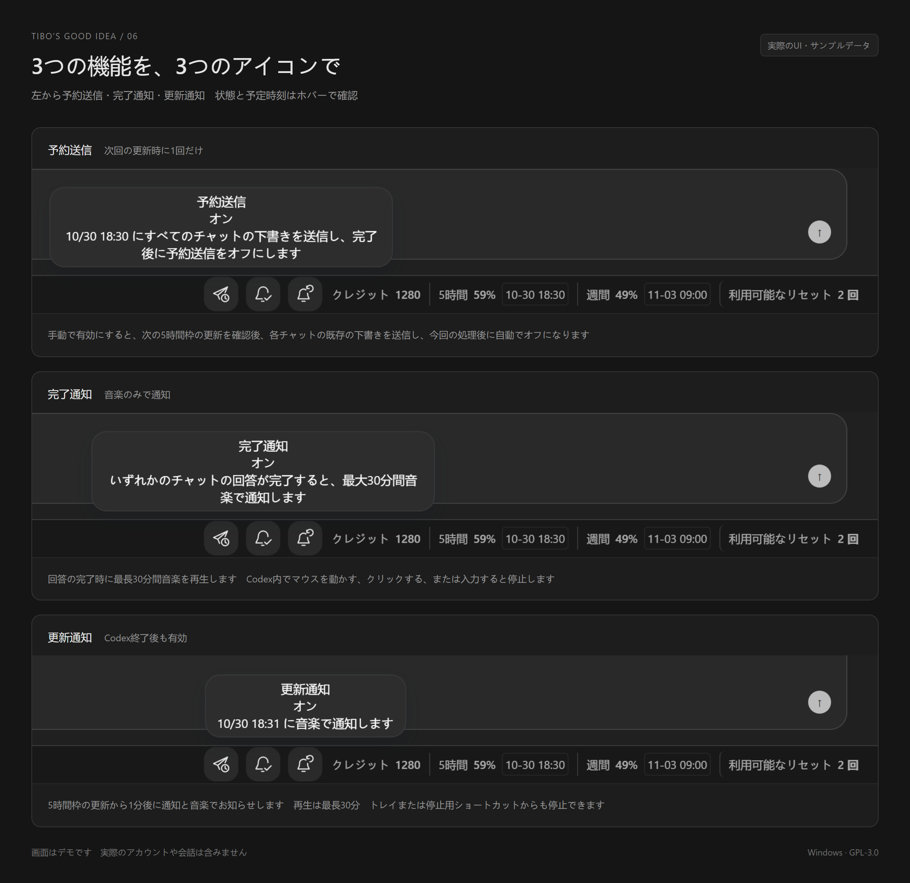

# Tibo’s Good Idea — Codex スキン・利用枠表示・ボトムバー

TibosGoodIdea / Tibo’s Good Idea 0.8.0-rc.17
Windows 版 Codex のデスクトップ用スキン・ボトムバーです 残り利用枠、5時間・週間の利用制限、リセット時刻、リセットまでのカウントダウン、利用可能なリセット回数を一列に表示します
下書きの予約送信、タスク完了通知、利用枠のリセット通知、音楽通知に対応し、中国語・英語・日本語を Codex の設定に合わせて切り替えます
由龙见象による独立したツールです OpenAI との提携や公式の推奨はありません
自作コードは GPL-3.0-only で公開しています

対応環境：Windows 11 x64、Microsoft Store 版 Codex 26.1027.3384.0

1. ZIP 全体を通常のフォルダーに展開し、Install.cmd を実行します 管理者権限は不要です
2. 初回は実行中のタスクを完了して Codex を終了し、Tibo’s Good Idea のショートカットから起動します
3. 公式の起動方法は変更しません 通常の入口から起動すると元のレイアウトになります

表示言語は Codex の中国語、英語、日本語の設定に自動的に合わせます
言語の選択欄はありません Codex で言語を変更すると、下部バーとツールチップがすぐに更新されます
トレイと更新通知にも同じ言語を使用し、Codex 終了後は最後に認識した言語を保持します

## 3つのアイコン

- 予約送信：手動でオンにすると、次の使用量の更新確認後にすべてのチャットの既存の下書きを1回送信し、オフになります Codex の起動が必要です 有効にする前にすべての下書きを確認してください
- 完了通知：接続されたチャットの回答が完了すると音楽を最大30分間再生します 追加の完了通知は表示しません
- 更新通知：5時間の使用量の更新から1分後に通知して音楽を最大30分間再生します 設定済みの通知は Codex 終了後も有効です

Pro アカウントに5時間の制限がないことを確認できた場合、その利用枠は非表示となり、予約送信と更新通知は対象外として既存の予約を取り消します
週間の利用枠、購入クレジット、利用可能なリセットと完了通知は引き続き利用できます データを取得できない場合は制限なしとは判定しません

Codex 内でのマウス移動、クリック、入力で音楽を停止します 別のアプリでマウスを動かしても停止しません
Codex が閉じていても、トレイまたは StopSound.cmd から停止できます
PC の電源が入り、スリープしていない必要があります 自動復帰やログオン時の自動起動は設定しません

## 設定と削除

Settings.cmd ではタイムゾーンと WAV を設定できます 音声欄が空の場合は内蔵音を使用します
タイムゾーン auto は中国語では北京時間、英語と日本語では Windows のローカル時間を使用します
変更は次回のツール起動時、または Reload.cmd で反映します
Restore.cmd は元のレイアウトに戻し、通知サービスは継続します
ExitReminders.cmd はすべての通知を解除してサービスを終了します
Uninstall.cmd は管理対象のファイルを削除し、設定をバックアップします 外部の音楽は削除しません

このツールには Codex のアカウント、サブスクリプション、追加使用量は含まれません
使用条件は LICENSE.en.md / LICENSE.zh-CN.md、第三者のライセンスは THIRD-PARTY-NOTICES.md を確認してください
起動時に署名付き適応表を確認します 大きな構造変更には更新版が必要な場合があります 問い合わせは GitHub Issues を利用してください

独自コード、SVG アイコン、文書は GPL-3.0-only です 変更版の配布時は対応するソースの提供など GPL の条件に従ってください
Node.js、Acorn、録音素材はそれぞれ元の権利を保持します

## 更新

rc.14 以前からの更新では rc.16 を一度手動でインストールしてください 対応する修正をバックグラウンドで準備し、Codex を終了した後の次回 TiBo 起動時に適用します
新機能は Update.cmd で確認できます 送信中、再生中、2分以内の通知予定がある場合は適用を延期します

