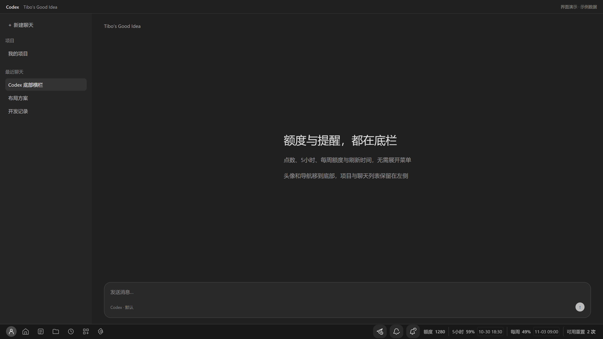
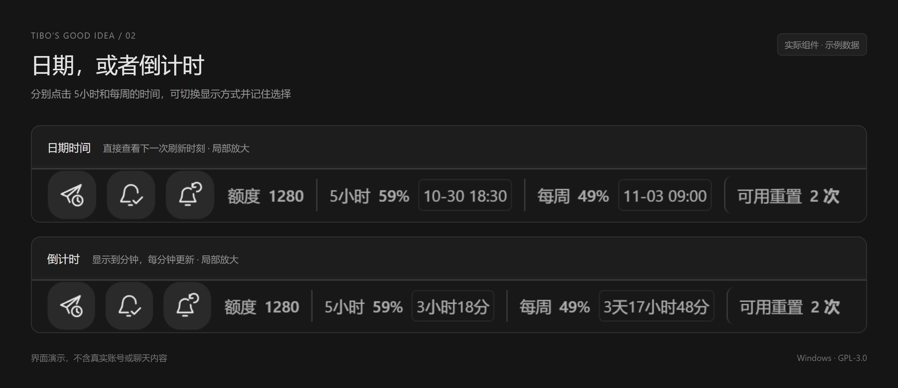
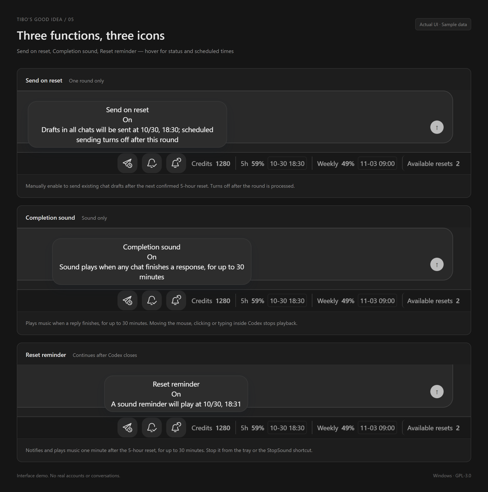
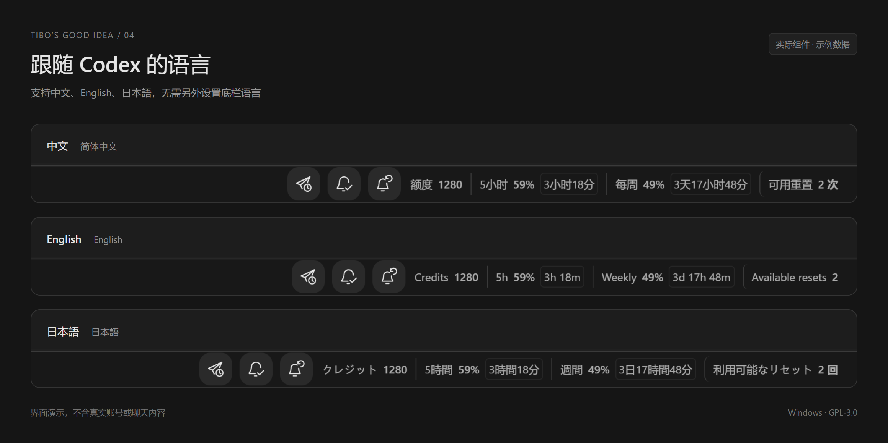

# Tibo’s Good Idea — Codex Quota Bar & Desktop Skin

[中文](README.md) · [Install](QUICKSTART.en.md) · [日本語](QUICKSTART.ja.md)

A Windows Codex desktop skin and single-row quota bottom bar. Original code is open source under **GPL-3.0-only**
The icon rail moves to the bottom with the profile at the far left, followed by purchased credits, separate five-hour and weekly quota, reset times and available resets
Repository: TibosGoodIdea · Version: **0.8.0-rc.15**

An independent project with no affiliation with or endorsement by OpenAI or Tibo
The source license does not constitute OpenAI approval of this client integration

Search terms: Codex skin, Codex theme, desktop customization, remaining quota, usage monitor, five-hour quota, weekly quota, reset time, reset countdown, available resets, scheduled draft sending, completion sound and quota reset reminder
中文关键词・日本語の検索キーワード: [Multilingual feature index](README.md#搜索关键词--search-terms--検索キーワード)

## Features

- Send on reset: manually arm one round of existing, non-empty chat drafts after the next confirmed five-hour reset, using native submission, then turn off
- Completion sound: play music when a connected chat finishes, for at most 30 minutes, without an additional completion notification
- Reset reminder: notify and play music one minute after the five-hour reset, for at most 30 minutes; an already scheduled alarm survives closing Codex
- Mouse movement, clicks or keyboard activity in Codex stop playback; the tray or StopSound.cmd can stop it without opening Codex
- Click a time to switch between a date and a minute-updated countdown; choices persist; language follows Codex in Chinese, English and Japanese

Windows must stay awake and running. There is no wake timer or logon task
Codex must remain open for scheduled sending. Review all drafts before arming it

## Install and adapt

Download the Windows-x64 ZIP from [Releases](https://github.com/HunDunJie/TibosGoodIdea/releases), extract everything, run Install.cmd and use the generated shortcut
Existing users can run the new Install.cmd to upgrade. Install this version once to obtain automatic adaptation
Finish tasks and close Codex yourself before starting; the launcher does not force-close Codex
Use Uninstall.cmd or Windows Installed Apps to uninstall

Checked on Windows 11 x64 / Microsoft Store Codex **26.1027.3384.0**
At startup, syntax and export relationships are inspected instead of blocking the entire add-on by version
A signed adapter catalog is checked in the background, normally every 12 hours, with priority checks after client fingerprint or capability changes. Entries require exact renderer SHA-256 fingerprints
Offline startup uses bundled entries, verified cache or local discovery. Changed interfaces disable only the affected draft or completion feature
Major structural changes may still require maintenance. Future compatibility is not guaranteed; see [COMPATIBILITY.md](COMPATIBILITY.md)

This uses a local debugging connection, leaves Codex installation files and native launch entries unchanged, and uses the original layout after a full native cold start
Only fixed signed public indexes and approved project GitHub release packages are requested. Account data, quota, drafts, client code and personal settings are not uploaded. Full programs require a separate signature and verified inventory; adapter data cannot inject JavaScript

## Automatic updates

Install rc.15 manually once to obtain the updater. Compatible fixes download in the background, then activate on a later TiBo launch with Codex and the controller closed
TiBo fixes can apply even when Codex has not changed. Releases for other client builds are ignored
Use Update.cmd for optional features. Sending, playback or an alarm due within two minutes postpones activation
Settings, send batches and alarms are retained, with code rollback on failure; see [update rules](docs/program-updates.md)
Future versions must still be verified and signed by the maintainer

## Preview

Actual TiBo UI code with sample data and a mock host; these are not live Codex client screenshots

[Chinese feature guide](docs/images/03-feature-tooltips.png) · [日本語の機能説明](docs/images/06-feature-tooltips-ja.png)

## Build and verify

Requires Node.js 22+, Python 3, Windows PowerShell 5.1 and Microsoft Edge
Run download-runtime.ps1 for the pinned, checksum-verified official Node binary, then `python pack-buyer.py --manifest-only` and Start.cmd
Use `npm install --ignore-scripts`, `npm test` and the package scripts for UI, language, display, volume, native adapter, reset rescheduling, controller, worker, installer and lifecycle checks
Windows CI is included. `python pack-buyer.py` builds the Windows bundle and hashes; `python pack-source.py` builds corresponding source
Personal config, runtime state, signing private keys, downloaded Node.exe and dist are excluded from Git
See [adapter maintenance](updates/README.md) and [change evidence](docs/automatic-adaptation.md)
Mock tests do not establish full Codex cold start, notification activation or real multi-chat submission acceptance

## License

Original code, SVG icons and documentation: [GPL-3.0-only](LICENSE), retaining contributor copyrights
Distributed modifications must comply with GPL source requirements; GPL permits charging for copies
Node, Acorn and bundled recordings retain their own rights; see [license scope](LICENSE.en.md) and [third-party notices](THIRD-PARTY-NOTICES.md)
The sales directory is an archive of earlier preparation, not the current license or an active sales channel
