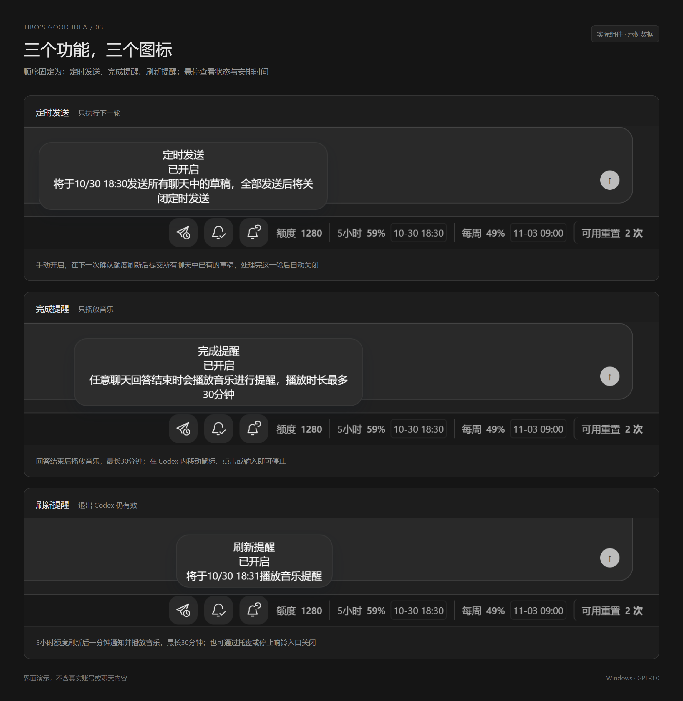

# Tibo’s Good Idea — Codex 额度底栏与桌面皮肤

[English](README.en.md) · [中文安装说明](QUICKSTART.zh-CN.md) · [日本語](QUICKSTART.ja.md)

Windows Codex 的单行底栏附加工具，自有代码按 **GPL-3.0-only** 开源
将最左侧图标导航移至底部，头像在最左边；同一行显示点数、5 小时额度、每周额度、刷新时间和可用重置
项目目录和 GitHub 仓库名为 TibosGoodIdea，当前版本 **0.8.0-rc.16**

**English:** A Windows Codex desktop skin and quota bottom bar showing remaining usage, five-hour and weekly limits, reset times, reset countdowns and available resets, with scheduled draft sending and music reminders

**日本語:** Windows 版 Codex のデスクトップ用スキン・ボトムバー 残り利用枠、5時間・週間の利用制限、リセット時刻、リセットまでのカウントダウン、利用可能なリセット回数を表示し、下書きの予約送信と音楽通知に対応します

这是非官方项目，与 OpenAI 及 Tibo 没有关联或背书关系
开源许可只涉及本项目自有代码，不代表 OpenAI 已批准该客户端集成方式

## 功能

- 定时发送：手动开启后，在下一次确认的 5 小时额度刷新后，通过原有提交入口发送各聊天已有的非空草稿，只执行一轮
- 完成提醒：任意已连接聊天回答结束时播放音乐，最多 30 分钟，不额外弹出完成通知
- 刷新提醒：5 小时额度刷新后一分钟弹出通知并播放音乐，最多 30 分钟；已安排的提醒在退出 Codex 后仍有效
- 鼠标在 Codex 内移动、点击或键盘操作会停止播放；托盘菜单和 StopSound.cmd 可在 Codex 未开启时停止
- 日期与倒计时可点击切换并记住选择，倒计时每分钟更新；中文、英文、日文跟随 Codex
- 确认 Pro 账户没有 5 小时限制时隐藏该额度栏，定时发送和刷新提醒显示“不适用”并取消旧安排；每周额度、点数、可用重置及完成提醒照常使用，读取不到的数据仍显示未知

Windows 须保持开机且未睡眠，不会唤醒电脑，也不会安装登录自启任务
定时发送需保持 Codex 和底栏运行，请在开启前检查各聊天草稿

## 安装与更新

从 [Releases](https://github.com/HunDunJie/TibosGoodIdea/releases) 下载 Windows-x64 ZIP，完整解压后运行 Install.cmd，再使用生成的快捷方式
已有安装可运行新版 Install.cmd 升级；首次升级到本版后，才具备以下自动适配机制
运行中的任务请先结束，再手动退出 Codex；工具不会强制关闭客户端
卸载使用 Uninstall.cmd 或 Windows 已安装应用中的卸载入口，详见安装说明

当前检查环境：Windows 11 x64，Microsoft Store Codex **26.1027.3384.0**
启动时按语法和导出关系识别接口，不再按版本号阻止整个底栏
启动后在后台检查签名适配表，通常每 12 小时检查一次；Codex 指纹或能力变化时优先检查，仅模块 SHA-256 全部匹配的表项可用
断网时使用随包表、已验证缓存或本地识别；草稿或完成事件接口有变时仅暂停相关功能
大幅结构变化仍可能需要维护者适配，不能保证任意未来版本都自动兼容
详见 [兼容性与适配](COMPATIBILITY.md)

实现使用本机调试连接，不修改 Codex 安装文件或原生启动入口；从原生入口完全冷启动仍使用原界面
远端仅请求固定的公开签名索引，以及索引认可的本项目 GitHub 版本包；不上传账号、额度、草稿、客户端代码或个人配置
完整程序更新有独立签名和逐文件校验，不能通过适配表注入 JavaScript

## 自动更新

首次手动安装 rc.16 后，启动时会在后台检查并下载适配当前 Codex 的修复，下次 Codex 和控制器均关闭后再从 TiBo 启动时安全切换
Codex 没更新时也能接收 TiBo 自身修复；仅支持其他客户端的版本不会下载
新增功能可通过 Update.cmd / 检查更新.cmd 手动检查；正在发送、响铃或两分钟内有提醒时会推迟更新
设置、定时发送批次与提醒计划保留，切换失败可回退；[完整更新规则](docs/program-updates.md)
rc.14 及更早版本需要先手动升级一次；未来版本仍需维护者验证并发布签名索引

## 功能预览

以下均使用实际界面代码与示例数据渲染，演示外壳不是实机 Codex 截图

英文与日文功能图见 [English](docs/images/05-feature-tooltips-en.png) · [日本語](docs/images/06-feature-tooltips-ja.png)

## 源码与验证

需要 Node.js 22+、Python 3、Windows PowerShell 5.1 和 Microsoft Edge
运行 download-runtime.ps1 下载校验固定版本的官方 Node；运行 `python pack-buyer.py --manifest-only` 后可用 Start.cmd 启动
开发依赖使用 `npm install --ignore-scripts`，运行 `npm test` 及 package.json 中的 UI、语言、显示、音量、适配器、发送重排、控制器、安装卸载和后台测试
Windows CI 在 .github/workflows/test.yml

`python pack-buyer.py` 生成完整 Windows 包及 SHA-256，`python pack-source.py` 生成对应源码包
个人配置、后台状态、签名私钥、下载的运行时和 dist 均不进入 Git
签名维护流程见 [updates/README.md](updates/README.md)，本次改动与验证见 [docs/automatic-adaptation.md](docs/automatic-adaptation.md)
模拟测试不会发送真实草稿或播放真实音乐，真实冷启动、通知返回和真实多聊天发送仍需单独验收

## 搜索关键词 / Search terms / 検索キーワード

| 中文 | English | 日本語 |
| --- | --- | --- |
| Codex 皮肤、界面美化 | Codex skin, desktop theme | Codex スキン、テーマ、UI カスタマイズ |
| Codex 底栏、底部导航栏 | Codex bottom bar, bottom navigation | Codex ボトムバー、下部ナビゲーション |
| 剩余额度、用量显示、额度监控 | remaining quota, usage display, quota monitor | 残り利用枠、使用量表示、利用状況モニター |
| 五小时额度、每周额度 | five-hour quota, weekly quota | 5時間の利用枠、週間利用枠 |
| 刷新时间、重置时间、刷新倒计时 | reset time, quota reset countdown | リセット時刻、リセットまでのカウントダウン |
| 可用重置、重置次数 | available resets, reset credits | 利用可能なリセット回数、リセットクレジット |
| 定时发送、草稿自动发送 | scheduled draft sending, send on quota reset | 下書きの予約送信、利用枠リセット後の自動送信 |
| 完成提醒、任务结束提醒 | task completion reminder, completion sound | タスク完了通知、回答完了通知 |
| 刷新提醒、音乐提醒 | quota reset reminder, music notification | リセット通知、音楽通知 |
| 中英日多语言、Windows 桌面工具 | multilingual Windows desktop utility | 中国語・英語・日本語対応、Windows デスクトップツール |

## 许可证

自有代码、图标和说明为 [GPL-3.0-only](LICENSE)，保留原贡献者版权声明
分发修改版也须按 GPL 提供相应源码，允许按 GPL 收费分发
Node、Acorn 和内置音乐分别保留原有权利，范围见 [许可说明](LICENSE.zh-CN.md) 与 [第三方声明](THIRD-PARTY-NOTICES.md)
历史 sales 目录仅保留旧版准备记录，不是当前发布许可或已开通的销售渠道
