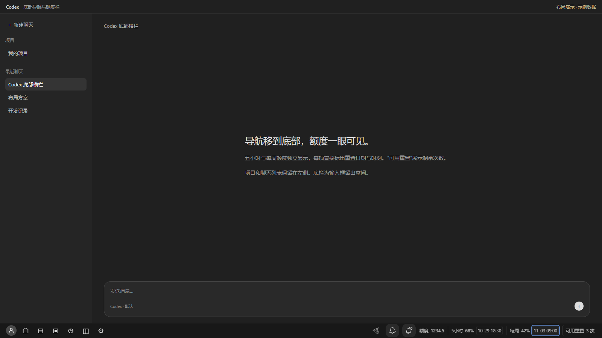

# TibosGoodIdea

Windows Codex 底栏助手，产品显示名为 Tibo’s Good Idea

正式源码项目与 GitHub 私有仓库名均为 TibosGoodIdea，销售资料在 sales/，生成的 ZIP 和校验文件在 dist/
个人配置、运行状态、下载的 Node.exe 和 dist/ 不提交到 Git，原有 productId 保留以兼容设置
项目结构与迁移记录见 [docs/PROJECT.md](docs/PROJECT.md)

[English](README.en.md) · [中文快速开始](QUICKSTART.zh-CN.md) · [兼容性](COMPATIBILITY.md)

版本 **0.8.0-rc.4**，本地发布候选包，尚未公开上架。由龙见象整理的第三方 Windows 工具，与 OpenAI 无隶属或背书关系

把 Codex 最左侧的图标导航移到底部，在一行中显示购买点数、五小时额度、每周额度、刷新时间与可用重置次数。头像保留在最左，项目和聊天列表保留在左侧



三个线条图标从左到右：

| 功能 | 行为 |
| --- | --- |
| 定时发送 | 每次手动开启，等待下一次确认额度刷新后，提交已有聊天中的非空草稿，一轮后关闭；需要 Codex 运行 |
| 完成提醒 | 任一连接的聊天回答完成后播放音乐，最多 30 分钟，不额外发完成通知 |
| 刷新提醒 | 五小时刷新后一分钟通知并播放音乐，最多 30 分钟；已安排的提醒在退出 Codex 后仍有效 |

在 Codex 内移动鼠标、点击或输入会停铃。托盘和 StopSound.cmd 可在不打开 Codex 时停铃。提醒服务需要 Windows 保持开机且未休眠，未设置开机自启或唤醒电脑

时间可分别点击切换日期与倒计时，按分钟更新并保存选择。额度数字不加千位逗号，空间不足时信息区横向滚动，底栏保持单行。按钮开关及运行信息放在三行悬浮提示中

## 使用

当前仅支持 **Windows 11 x64 / Microsoft Store Codex 26.1023.6621.0**。其他版本会停止加载

买家完整包已附带官方 Node.js 24.22.1 与两段原创提示音，无需另外安装 Node。解压后运行 Install.cmd，使用桌面的 Tibo’s Good Idea 启动，语言直接跟随 Codex，支持中文、English 和日本語；Settings.cmd 只设置时区和 WAV。详见快速开始

本工具使用本机回环调试接口，并非官方主题 API。不修改 Codex 安装文件、官方快捷方式或 Windows 原生入口。首次加载前需完成任务并自行退出 Codex；完全退出后从官方入口启动仍为原布局

## 私有源码备份与开发

需要 Node.js 22+、Python 3、Windows PowerShell 5.1 和 Microsoft Edge

```powershell
powershell.exe -NoProfile -ExecutionPolicy Bypass -File download-runtime.ps1
python pack-buyer.py --manifest-only
.\Start.cmd
```

源码不包含 Node 可执行文件；download-runtime.ps1 只从官网获取固定版本并核对 SHA-256。个人音乐、配置、运行状态、日志和真实账户截图不进入源码或买家包

## 验证

```powershell
npm install --ignore-scripts
npx playwright install msedge
npm test
npm run test:ui
npm run test:language
npm run test:display
npm run test:volume
npm run test:adapter
npm run test:controller
npm run test:worker
npm run test:install
npm run test:settings
```

本版完整回归记录见 sales/verification.json，语言实时切换、日语、托盘同步和移除选择器的设计与检查见 docs/language-follow.md。播放测试使用静音 WAV，不发送真实草稿

完整 Codex 冷启动、通知点击回前台、真实多聊天提交与真实任务结束事件仍需独立验收，自动化模拟通过不代表这些流程已验证。当前聊天承载的 Codex 未被重启，底栏已加载本版并确认跟随当前 Codex 语言

## 许可证与发布

自有代码、原创图标和内置提示音按[商业自用许可草案](LICENSE.zh-CN.md)准备，保留既有贡献者与卖家版权声明。购买者可在自己使用的设备上用于个人或商业工作，不授予转售或公开分发本工具的权利。Node.js 及第三方组件继续适用原许可证，详见 THIRD-PARTY-NOTICES.md。源码留作卖家私有备份，不公开上传

建议商品标价为国内 **¥3.90**、海外 **US$0.90**。当前没有公开仓库或销售链接。OpenAI 支持已按用户转述升级至专员，目前等待回复，不把受理或排队视为批准。若当前方案不获允许，则不销售；还需完成实际客户端与收款交付验收

`python pack-source.py` 生成卖家私有源码 ZIP，不用于买家交付；`python pack-buyer.py` 生成买家 ZIP、逐文件校验清单和 SHA-256
